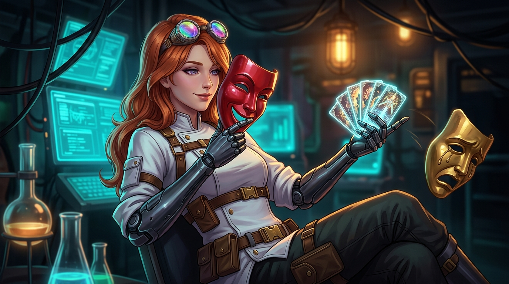

<p align="center">
  
</p>

# Inner Entity 🎭
### *Giving characters minds of their own with Entity Cards~*
Originally created as **Inner Self** by **LewdLeah** ❤️  
Optimized Context patch by **XloSky**  
Expanded with **Entity Cards (NER)** and maintained by **Randy Viosca** ([@Random_Variable](https://play.aidungeon.com/profile/Random_Variable))  

---

## Overview

**Inner Entity** combines the character-mind simulation of LewdLeah's **Inner Self** with the structured Named Entity Recognition (NER) and token-dense YAML world-building of Randy Viosca's ([@Random_Variable](https://play.aidungeon.com/profile/Random_Variable)) **Entity Cards**, fully updated with XloSky's **Optimized Context** compatibility patch.

Simulated NPCs build, reflect upon, and maintain their own mental state (goals, secrets, opinions, private plans) while the world around them is dynamically indexed into token-calibrated Entity Cards across 5 types: **Person**, **Location**, **Organization**, **Thing**, and **Event**.

---

## Key Features

| Feature | Description |
|:---|:---|
| **Segmented Character Minds** | Each NPC maintains their own private mental state, separate from other characters |
| **Optimized Context Support** | Fully compatible with AI Dungeon's *Optimized Context* prompt caching via dynamic task cards |
| **Smart Trigger Scoring** | Narration mentions outweigh dialogue mentions (3:1), preventing absent characters from thinking |
| **Named Entity Recognition (NER)** | Automatically generates structured, token-dense YAML cards for people, places, factions, relics, and events |
| **100-Token Slider Calibrated** | Schemas complete reliably in a single turn (~94 tokens) under AI Dungeon's default response slider |
| **Model-Aware Presets** | Auto-detects story model tier (DeepSeek, Gemma, Wayfarer, Muse) to select Standard, Lite, or Authoring schemas |
| **Two-Card Configuration** | Modular configuration split between Master *Configure Auto-Cards* and Companion *Configure Entity Cards* |
| **Zero Immersion Breaks** | Thought formation and card generation occur naturally without intrusive continue prompts |
| **Real-Time Editors** | View or edit any NPC brain in story card notes, and customize live prompt templates in the companion card |
| **100% Backward Compatible** | Works with legacy `InnerSelf()` hooks and allows 1-click toggling back to Classic Auto-Cards |

---

## Scenario Script Installation Guide

1. Open the [AI Dungeon website](https://aidungeon.com/) on desktop.
2. Edit an existing scenario or create a new one.
3. Open the **DETAILS** tab at the top.
4. Scroll down to **Scripting** and toggle **ON → Scripts Enabled**.
5. Select **EDIT SCRIPTS**.

### 1. Library Tab
Open [`src/library.js`](src/library.js), copy the entire file, and paste it into your empty **Library** tab.

### 2. Input Tab
Paste the following into your empty **Input** tab:
```javascript
// Your "Input" tab should look like this
InnerEntity("input");
const modifier = (text) => {
  // Any other input modifier scripts can go here
  return { text };
};
modifier(text);
```

### 3. Context Tab
Paste the following into your empty **Context** tab:
```javascript
// Your "Context" tab should look like this
InnerEntity("context");
const modifier = (text) => {
  // Any other context modifier scripts can go here
  return { text, stop };
};
modifier(text);
```

### 4. Output Tab
Paste the following into your empty **Output** tab:
```javascript
// Your "Output" tab should look like this
InnerEntity("output");
const modifier = (text) => {
  // Any other output modifier scripts can go here
  return { text };
};
modifier(text);
```

5. Click the yellow **SAVE** button in the top right.

*Note: Existing scenarios referencing `InnerSelf("input")`, `InnerSelf("context")`, and `InnerSelf("output")` remain fully supported via backward-compatibility aliases.*

---

## Gameplay & Configuration

### In-Game Story Cards

When your adventure begins, the script generates:
1. **Configure Inner Entity:**
   - Controls NPC mind simulation, thought frequency, trigger distance, and character list.
   - At the bottom of the card notes, list your intelligent NPCs on separate lines (e.g. `Leah\nLily\nLydia`).
   - Toggle **`Install Entity Cards / Auto-Cards: true`** to activate automated world lore generation.
2. **Configure Auto-Cards (Master):**
   - Active when card automation is enabled.
   - Switch between **`Operating Mode: Entity Cards`** (structured YAML) and **`Classic Auto-Cards`** (free-form prose).
   - Configure cooldowns, common entity filters, and title bans.
3. **Configure Entity Cards (Companion):**
   - Appears when in Entity Cards mode.
   - Displays active preset (`Standard`, `Lite`, `Authoring`, `Custom`).
   - Allows live editing of the YAML generation templates right inside the card notes.

### Slash Commands

You can execute commands directly in the AID input bar:
- `/ec on` or `/ac on`: Force-enable card automation.
- `/ec preset lite` (or `standard`, `authoring`, `custom`): Switch schema preset on the fly.
- `/ec header Named Entities (NER):`: Customize the context header replacing `World Lore:`.
- `/ec manual <title>`: Instantly generate an entity card, bypassing common filters.

---

## For Scenario Creators

At the top of [`src/library.js`](src/library.js), creators can customize scenario defaults via `globalThis.MainSettings`:

```javascript
globalThis.MainSettings = (class MainSettings {
    static InnerEntity = {
        IMPORTANT_SCENARIO_CHARACTERS: "Leah, Lily, Lydia",
        IS_INNER_SELF_ENABLED_BY_DEFAULT: true,
        FIRST_SECOND_OR_THIRD_PERSON_POV: 2,
        PERCENTAGE_OF_RECENT_STORY_USED_FOR_BRAINS: 30,
        NUMBER_OF_ACTIONS_TO_LOOK_BACK_FOR_TRIGGERS: 5,
        ACTIVE_CHARACTERS_VISUAL_INDICATOR_SYMBOL: "🎭",
        THOUGHT_FORMATION_CHANCE_PER_TURN: 60,
        IS_AC_ENABLED_BY_DEFAULT: true, // Auto-start Entity Cards
    };

    static EntityCards = {
        DEFAULT_OPERATING_MODE: "entity", // "entity" or "classic"
        DEFAULT_EC_PRESET: "standard",    // "standard", "lite", "authoring", "custom"
        DEFAULT_EC_AUTO_PRESET: true,     // Automatically calibrate to story model
        DEFAULT_CARD_CREATION_COOLDOWN: 28,
        DEFAULT_EC_GENERATED_ENTRY_LIMIT: 700,
        DEFAULT_EC_CONTEXT_HEADER: "Named Entities (NER):",
        DEFAULT_FILTER_COMMON_ENTITIES: true,
    };
});
```

---

## Modular Architecture & Builds

Inner Entity is designed with a **clean, decoupled architecture** separating the character cognition host (`src/core.js`) from the card generation engine via a Git submodule (`submodules/Entity-Cards`).

### Available Distribution Files (No Node.js Required!)
For players and creators, pre-assembled, single-file scripts are committed directly to the repository:
- **Flagship (Inner Entity):** [`src/library.js`](src/library.js) or [`dist/inner-entity.js`](dist/inner-entity.js) — Inner Self character minds with XloSky prompt caching + Randy Viosca's Entity Cards (NER, JFSH schemas, YAML). (~498 KB)
- **Classic (Inner Self):** [`dist/inner-self-classic.js`](dist/inner-self-classic.js) — Inner Self character minds with XloSky prompt caching + LewdLeah's official upstream Auto-Cards (prose & bullet lists). (~436 KB)
- **Mind-Only (Pure Cognition):** [`dist/inner-self-minds-only.js`](dist/inner-self-minds-only.js) — Lightweight standalone character cognition with Optimized Context prompt caching and zero card engine code. (~132 KB)

### Automated GitHub Sync (100% Free)
You never have to manually build scripts or install tools if you don't want to:
- A cloud **GitHub Actions** workflow (`.github/workflows/sync.yml`) runs on GitHub's cloud.
- Automatically compiles all three distribution files whenever `src/core.js` or the submodule updates.
- Under the **Actions** tab on GitHub, you can click **"Run workflow"** anytime to sync with the latest upstream commits directly from your browser.

### Local Development & Build Commands
If you are developing locally:
```bash
# Clone with submodules
git clone --recurse-submodules https://github.com/viosca/Inner-Entity.git

# Build Flagship Entity-Cards version (src/library.js)
npm run build

# Build Classic Auto-Cards version (dist/inner-self-classic.js)
npm run build:classic

# Build Mind-Only version (dist/inner-self-minds-only.js)
npm run build:minds

# Build all three distribution targets
npm run build:all

# Update the Entity-Cards submodule to latest remote commit
npm run submodule:update
# Run automated lifecycle unit tests
npm test

# Run OpenRouter prompt benchmarking harness (requires OPENROUTER_API_KEY in .env)
npm run test:openrouter
```

---

## Unit Testing & Prompt Benchmarking

See the [`unittest/`](unittest/) directory for comprehensive testing tools:
- **`unittest/test_lifecycle.js`:** Automated offline unit testing in a simulated AI Dungeon sandbox. Tests hook execution, story card pinning, mutual exclusion, prompt caching, and backward compatibility across all 3 distribution files.
- **`unittest/test_openrouter.js`:** Live LLM prompt benchmarking harness. Test and calibrate prompts against DeepSeek V3, Gemma 2, and Llama 3 via [OpenRouter](https://openrouter.ai/) to ensure generated YAML stays within AI Dungeon's default 100-token slider.
- See [`unittest/README.md`](unittest/README.md) for complete instructions on obtaining a free OpenRouter key, configuring `.env`, and tweaking generation schemas.

---

## Credits & Attributions

- **LewdLeah:** Creator of the original **Inner Self** (January 3, 2026) and **Auto-Cards** (May 21, 2025). The architecture of segmented memories, autonomous reflection, and card synchronization is LewdLeah's foundational work.
- **XloSky:** Creator of the **Optimized Context** patch (build 2.8.0), solving server-side prompt cache discard via dynamic task cards, dialogue-vs-narration trigger weighting, and self-referential thought filtering.
- **Randy Viosca ([@Random_Variable](https://play.aidungeon.com/profile/Random_Variable)):** Creator of **Entity Cards**, contributing Named Entity Recognition (NER), token-density calibration for AID's 100-token slider, two-card architecture, model-aware presets, fence cleaners, and maintainer of **Inner Entity**.
- **Community:** Pull requests and benchmark contributions by dirtymined13, -Vinny-, and testers across the AI Dungeon community.
