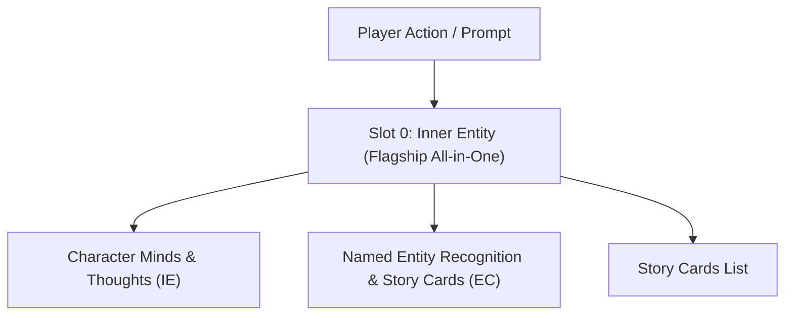
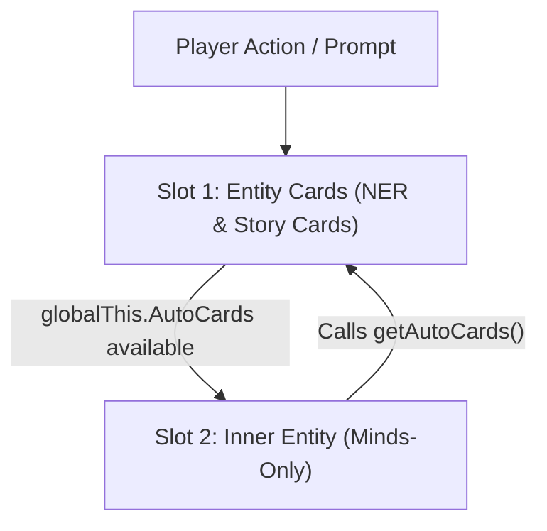

# Inner Entity Ecosystem: Configuration Matrix & Architecture Guide 🧭

This document provides a comprehensive guide to the builds, deployment topologies, dependencies, and configuration options across **Inner Entity (IE)**, **Entity Cards (EC)**, **Auto-Cards (AC)**, and **AID-Getopt**.

---

## 1. Component Glossary

* **IE (Inner Entity / Inner Self):** Simulates autonomous non-player character (NPC) minds, personal goals, secrets, internal monologues, and reflection badges (`🎭`).
* **EC (Entity Cards):** Automated Named Entity Recognition (NER) engine generating structured, token-calibrated YAML/Lorebook cards for People (with MBTI profiles), Locations, Organizations, Things, and Events.
* **AC (Auto-Cards):** LewdLeah’s original, lightweight prose-based story card generator that synthesizes narrative summary paragraphs based on keyword appearance.
* **AID-Getopt:** POSIX/GNU command-line parser (`-s`, `-v`, `--help`) with an input unwrap engine for 3rd-person roleplay, authoring preambles, and action wrappers.
* **AID-Modules (AMS):** Cross-slot discovery and lifecycle registry for AI Dungeon scripts, exposing `/aid-modules`.

---

## 2. Builds & Distributions Matrix

| Build / Artifact | Bundled Components | Footprint | Primary Target Slot | Embedded Getopt? | Best For |
| :--- | :--- | :--- | :--- | :---: | :--- |
| **`inner-entity.js`**<br>*(Flagship All-in-One)* | **IE + EC**<br>*(Minds + NER Cards)* | ~550 KB<br>(~11,000 lines) | Single Slot (Slot 0 or 1) | **Yes**<br>*(Embedded in EC & IE)* | **All-in-one convenience.** Players wanting living NPC minds and structured lorebook cards in a single script slot without managing multi-slot dependencies. |
| **`inner-self-minds-only.js`**<br>*(Minds-Only / Plain)* | **IE Only**<br>*(Pure Cognition)* | ~150 KB<br>(~3,000 lines) | Slot 2 (Modular)<br>or Single Slot | **Yes**<br>*(Embedded in Core)* | **Thinkers only or modular setups.** Players who only want character thoughts and zero card generation, OR who pair it with a separate card engine in Slot 1. |
| **`inner-self-classic.js`**<br>*(Inner Self Classic)* | **IE + Classic AC**<br>*(Minds + Prose Cards)* | ~220 KB<br>(~4,500 lines) | Single Slot | **Yes**<br>*(Embedded in Core)* | **Vintage narrative play.** Character minds paired with LewdLeah’s classic paragraph card generation instead of YAML/NER schemas. |
| **`Entity-Cards/src/library.js`**<br>*(Entity Cards Standalone)* | **EC + AC Modes**<br>*(NER + Prose Cards)* | ~400 KB<br>(~8,000 lines) | Slot 1 (Modular)<br>or Single Slot | **Yes**<br>*(Embedded `getoptLong`)* | **Dedicated lore tracking.** Worldbuilding and entity logging without NPC thought simulation. Switchable between NER and Classic modes via config card. |
| **`Auto-Cards v1.1.3`**<br>*(Classic Upstream)* | **Classic AC Only**<br>*(Prose Paragraphs)* | ~75 KB<br>(~1,500 lines) | Single Slot or Slot 1 | **No**<br>*(Regex only)* | **Ultra-lightweight play.** Minimalist prose card generator with minimal QuickJS memory footprint. |
| **`library-aid-getopt.js`**<br>*(AID-Getopt Library)* | **Getopts Option Parser** | ~40 KB<br>(~1,100 lines) | Optional Developer Slot | **Native**<br>*(Full Engine)* | **Developer utility.** Standard POSIX/GNU flag parser and tokenizer for scenario creators building custom script commands. *(Note: `examples/library-sandbox.js` is an example demo scenario, not a required runtime slot).* |
| **`library-aid-modules.js`**<br>*(AID-Modules Registry)* | **AMS Registry & Discovery** | ~20 KB<br>(~500 lines) | Optional Utility Slot | **No**<br>*(Registry only)* | **Module inspector.** Optional utility exposing `/aid-modules` to list and verify all installed scripts across turns. |

---

## 3. Topologies & Top-Level Architectures

### Topology A: The Single-Slot "All-in-One" Powerhouse
A single script slot containing `dist/inner-entity.js`.



* **Pros:**
  * Maximum convenience: 1 script slot to install, update, or disable.
  * Generates both `Configure Inner Self` and `Configure Auto-Cards` automatically.
  * Zero cross-slot script coordination required.
* **Cons:**
  * Largest script footprint (~11,000 lines).
  * Updating card logic requires re-pasting or re-attaching the entire bundle.
  * In-game command output (e.g. `/ie help`) is processed within normal game text unless intercepted by an upstream router.
* **Dependencies:**
  * None. Completely self-contained with embedded getopt and card engine.

---

### Topology B: The Modular Two-Slot Pair (Standard Modular Setup)
The recommended setup when a player or creator wants to keep worldbuilding and character cognition in separate slots for independent updating.



* **Slot 1:** `Entity Cards (NER)` (Scenario: `05_w3s9zrrvt` / `Entity-Cards/src/library.js`)
* **Slot 2:** `Inner Entity (Minds)` (Scenario: `bL_qS9DsI5wI` / `dist/inner-self-minds-only.js`)

* **Pros:**
  * **Zero middleware required:** No need for a separate router or sandbox slot. Both scripts have `aid-getopt` embedded directly inside them.
  * **Full 3rd-person & authoring support:** Both `/ec` and `/ie` unwrap character prefixes (`> Jonathon /ie -s`) and authoring prompts independently.
  * **Independent upgradability:** You can update or tune Entity Cards without touching character mind simulation, or vice-versa.
  * **Clean separation of concerns:** Slot 1 owns lore, NER, and story cards; Slot 2 owns character brains, reflection, and thought simulation.
* **Cons:**
  * Requires managing two script slots in the adventure's Script Manager instead of one.
* **Dependencies:**
  * Slot 2 calls Slot 1 via `globalThis.AutoCards`.
  * Neither script has any external dependencies on `aid-getopt` or `aid-modules`—all option parsing and unwrapping is built right in.

---

### Topology C: The Optional Developer / Inspector Utilities (Add-Ons)
Scenarios like `AID-Modules` or `AID-Getopt` can be added optionally as slot add-ons:

* **`AID-Modules` (Scenario: `jHwEbn7_bYGC` / `library-aid-modules.js`):**
  * An optional module manager. If added, exposes `/aid-modules` to discover and report versions, git hashes, and health across all attached scripts.
* **`AID-Getopt` (Scenario: `library-aid-getopt.js`):**
  * A standalone developer library for script creators building their own custom slash commands (e.g. `/roll`, `/inventory`, `/stat`).
* **`AID-Getopt Example Sandbox` (`examples/library-sandbox.js`):**
  * A showcase demo scenario illustrating how developers can write custom RPG slash commands with getopt routing and output sandboxing. **Not required for standard gameplay.**

---

### Topology C: The "Thinkers Only" Setup
A single script slot containing `dist/inner-self-minds-only.js`.

* **Pros:**
  * Ultra-lightweight character cognition engine (~3,000 lines).
  * NPCs have inner thoughts, private goals, secrets, and reflection badges (`🎭`).
  * Leaves the player's Story Cards list 100% clean—no automatic lore or entity cards are created.
* **Cons:**
  * No automated world lore or NPC background card generation.
* **Dependencies:**
  * None. Standalone with embedded getopt parser in core.

---

### Topology D: The "Worldbuilders Only" Setup
A single script slot containing `Entity-Cards/src/library.js`.

* **Pros:**
  * Complete Named Entity Recognition (People, Locations, Factions, Items, Events).
  * Generates structured YAML/Lorebook cards and MBTI profiles automatically.
  * Supports toggling between NER mode and Classic Auto-Cards prose mode.
* **Cons:**
  * Characters do not simulate inner thoughts, private goals, or reflection badges.
* **Dependencies:**
  * None. Completely self-contained with embedded `getoptLong`.

---

## 4. Getopt Dependencies: Embedded vs. External

### Does IE (Minds-Only) or the All-in-One Bundle need an Embedded Getopt?

**Yes.** Here is why:

1. **Standalone Resilience:**
   If a user plays with `inner-self-minds-only.js` or `inner-entity.js` without `AID-Getopt Router` in Slot 0, any player command typed in 3rd-person mode (e.g. `> Jonathon /ie -s`) or with authoring preambles (`[AI, polish...] Author as Jonathon /ie -s`) would fail to match if relying solely on basic regex.
   
2. **Hard vs. Soft Dependencies:**
   * **Hard Dependency (Avoided):** Requiring `AID-Getopt` in Slot 0 to run at all. If the router were absent, commands would crash or silently fail.
   * **Soft Dependency / Progressive Enhancement (Implemented):**
     * `src/core.js` embeds a compact tokenizer, `unwrapCommandInput()` helper, and POSIX/GNU flag parser directly in the script.
     * When running standalone, `/ie` commands parse cleanly with full 3rd-person, author mode, and quote handling.
     * When `AID-Getopt Router` is present in Slot 0, `core.js` detects `globalThis.AIDGetopt` and delegates command output trapping to the master sandbox to save context tokens.

---

## 5. Cross-Script Waterfall Mechanics

In AI Dungeon, each turn executes scripts sequentially within the **same QuickJS JavaScript runtime context**:

```
Hook: onInput
  Slot 0: AID-Getopt Router (normalizes command, unwraps text)
    ↓
  Slot 1: Entity Cards (initializes globalThis.AutoCards)
    ↓
  Slot 2: Inner Entity (reads globalThis.AutoCards, calls getAutoCards())
```

### Key Execution Rules:
1. **Downstream CAN call Upstream (Slot 2 $\rightarrow$ Slot 1):**
   Because Slot 1 executes before Slot 2, any objects attached to `globalThis` by Slot 1 (`globalThis.AutoCards`, `globalThis.EntityCards`) are already in memory when Slot 2 executes. Slot 2 can call Slot 1 JS functions directly.
2. **Upstream CANNOT call Downstream (Slot 0 $\rightarrow$ Slot 2 in the same turn):**
   When Slot 0 executes, Slot 1 and Slot 2 have not run yet for that turn.
3. **`globalThis` vs. `state` Persistence:**
   * `globalThis` is completely reset on every turn by QuickJS.
   * `state` is the **only** object serialized and persisted across turns in the database.
   * To allow Slot 0's `/aid-modules` command to discover Slot 1 and Slot 2, downstream modules register their manifest into `state._aid_modules`. Slot 0 reads `state._aid_modules` on subsequent turns, achieving full two-way discovery across the ecosystem.
