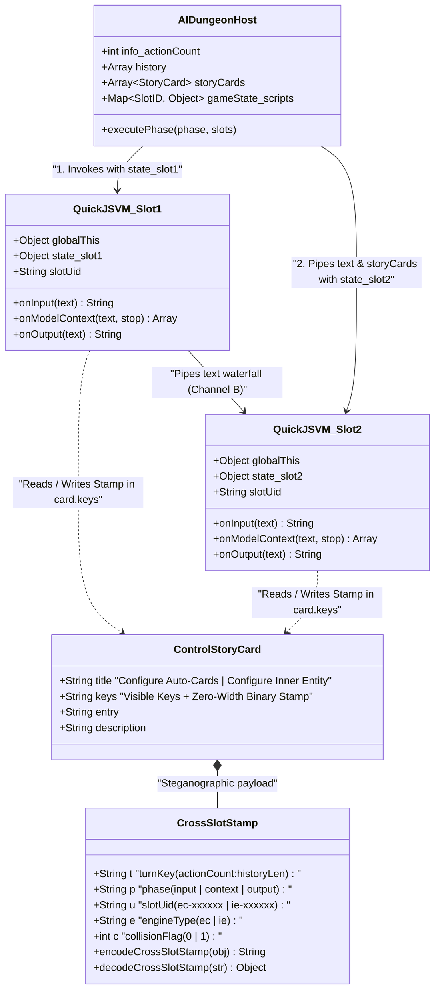
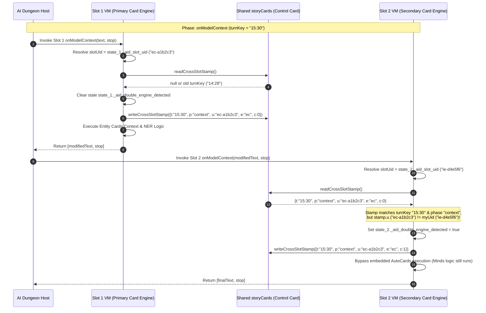
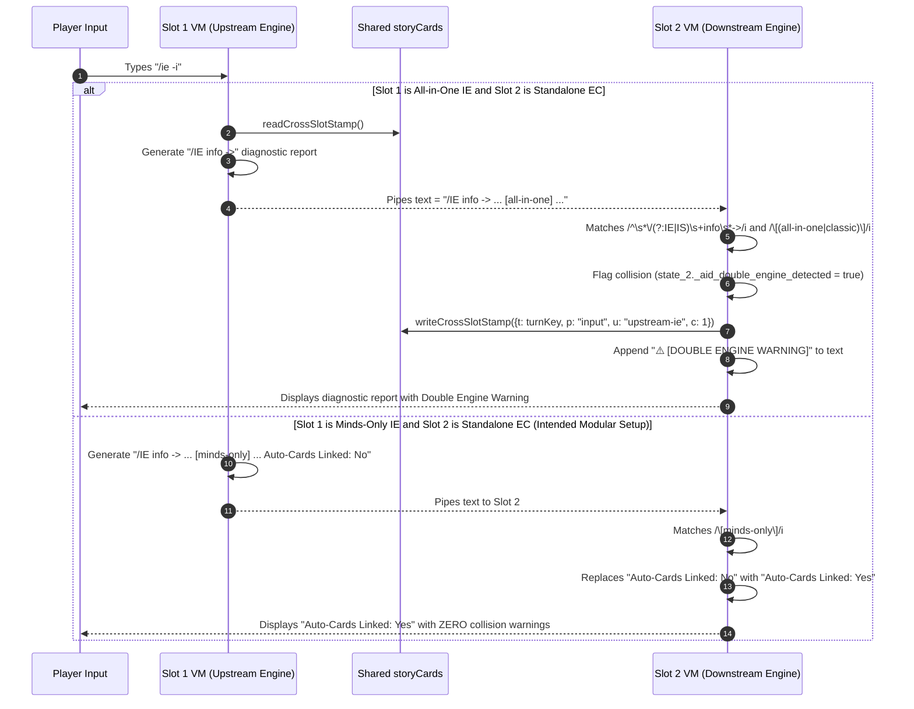
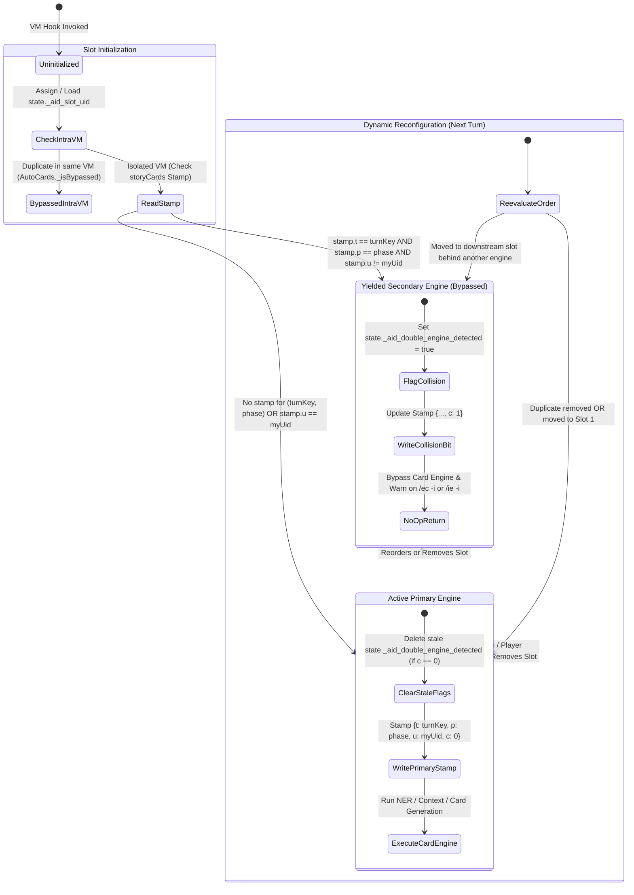

# AI Dungeon Multi-VM Cross-Slot Coordination Protocol

## 1. Executive Summary & Architectural Problem

In AI Dungeon **Adventure Mode**, players can attach multiple scripts to an adventure and dynamically reorder, add, or remove them at any time via the Script Manager.

### The QuickJS Isolation Model
AI Dungeon executes each script slot in a **separate, isolated QuickJS Virtual Machine (VM)** instance per lifecycle phase (`onInput`, `onModelContext`, `onOutput`):
- **`globalThis` is ephemeral and isolated:** Each slot starts with a fresh global scope on every hook execution. Globals defined in Slot 1 do **not** exist in Slot 2.
- **`state` is isolated per slot:** The backend namespaces `state` per script (`gameState.scripts[scriptShortId]`). Slot 1 cannot read or write Slot 2's `state` object.
- **Run order is mutable:** A player can drag Slot 2 above Slot 1 mid-adventure, or delete a duplicate slot on the fly.

### Shared Surface Area Across VMs
Only the turn pipeline parameters and shared story array cross VM boundaries:
1. **`text` (and `stop`):** Piped sequentially as a waterfall ($Slot_1 \to Slot_2 \to \dots \to Slot_N$).
2. **`storyCards`:** A shared mutable array of card objects passed across all slots and persisted to the adventure database across turns.
3. **`history` & `info`:** Read-only shared turn context (`info.actionCount`, `history.length`).
4. **`state.memory` & `state.message`:** Shared player-facing memory and toast buffers.

---

## 2. Protocol Overview: Dual-Channel Hybrid IPC

To prevent **Double Engine Collisions** (e.g., when a player loads both standalone `Entity-Cards` and `All-in-One Inner-Entity` in separate slots) while enabling **Modular Discovery** (e.g., `Entity-Cards` in Slot 1 + `Inner-Entity Minds-Only` in Slot 2), the protocol uses two complementary, zero-leakage channels:

1. **Channel A — `storyCards` Zero-Width Steganographic Stamp (Persistent & Order-Independent):**
   - Encodes a compact JSON telemetry payload into invisible zero-width Unicode bits (`\u200B` = `0`, `\u200C` = `1`) bounded by sentinel delimiters (`\u200D\u200C\u200D` ... `\u200D\u200B\u200D`).
   - Appended to the `keys` property of existing control cards (`Configure Auto-Cards`, `Configure Entity Cards`, or `Configure Inner Entity`).
2. **Channel B — `text` Waterfall Stream Handshakes (Turn-Scoped & Immediate):**
   - Uses zero-width token `\u200D\u200B\u200C\u200B\u200D` (`EC_INPUT_HANDSHAKE`) and structured command response prefixes (`/EC ... ->`, `/IE info ->`) in the `onInput` waterfall to coordinate diagnostic banners and command routing within a single turn.

> [!IMPORTANT]
> Because `storyCards` control cards are not triggered as story lore and zero-width characters have zero visual footprint, neither the player nor the LLM context prompt ever sees the protocol metadata.

---

## 3. UML Component & Data Architecture



---

## 4. Wire Format & Encoding Specification

### 4.1 Channel A: Zero-Width Binary Stamp (`storyCards[i].keys`)

Each byte of the UTF-8 JSON payload is serialized MSB-first (bits 7 down to 0) into 8 zero-width characters:

| Element | Unicode Sequence | Purpose |
| :--- | :--- | :--- |
| **`STAMP_START`** | `\u200D\u200C\u200D` (ZWJ + ZWNJ + ZWJ) | Marks start of steganographic frame |
| **Bit `0`** | `\u200B` (Zero-Width Space, ZWSP) | Binary 0 |
| **Bit `1`** | `\u200C` (Zero-Width Non-Joiner, ZWNJ) | Binary 1 |
| **`STAMP_END`** | `\u200D\u200B\u200D` (ZWJ + ZWSP + ZWJ) | Marks end of steganographic frame |

#### JSON Payload Schema
```json
{
  "t": "12:24",
  "p": "context",
  "u": "ec-8f92a1",
  "e": "ec",
  "c": 0
}
```

- **`t` (`turnKey`):** Composite key `"${info.actionCount}:${history.length}"`. Identifies the exact turn and prevents stale stamps from previous turns from triggering false collisions.
- **`p` (`phase`):** Current hook execution phase (`"input"`, `"context"`, or `"output"`).
- **`u` (`slotUid`):** Persistent per-slot identifier generated once and stored in `state._aid_slot_uid` (prefixed with `"ec-"` for standalone Entity-Cards or `"ie-"` for bundled Inner-Entity).
- **`e` (`engine`):** Engine flavor claiming primary ownership (`"ec"` or `"ie"`).
- **`c` (`collision`):** `0` when normal; `1` when a downstream slot detected another card engine during the same `turnKey` + `phase`.

### 4.2 Channel B: `text` Stream Handshakes (`onInput`)

| Token / Pattern | Value / Regex | Role |
| :--- | :--- | :--- |
| **`EC_INPUT_HANDSHAKE`** | `\u200D\u200B\u200C\u200B\u200D` | Emitted by upstream standalone EC during `onInput`, stripped by downstream IE to confirm upstream EC presence. |
| **EC Command Banner** | `/^\s*\/(?:EC\|AC)\b[^\n]*->/i` | Detected by downstream engines when upstream EC processes `/ec -i` or another command. |
| **IE Diagnostic Banner** | `/^\s*\/(?:IE\|IS)\s+info\s*->/i` | Inspected by downstream standalone EC to either inject a Double Engine Warning (if IE is `all-in-one`/`classic`) or flip `Auto-Cards Linked: No` $\to$ `Yes` (if IE is `minds-only`). |

---

## 5. UML Sequence Diagrams

### 5.1 Double Engine Collision Detection & Bypass (`onModelContext` / `onOutput`)

When a player accidentally installs two card engines in separate slots (e.g., Slot 1 Standalone `Entity-Cards` + Slot 2 `All-in-One Inner-Entity`, in **any** slot order):



---

### 5.2 Diagnostic Command Handshake (`/ec -i` & `/ie -i` across VMs)

Because `/ec -i` or `/ie -i` is handled during `onInput`, the upstream slot generates the diagnostic report before it knows whether a downstream slot also has a card engine. The downstream slot intercepts the formatted output in `text` and augments it in-flight:



---

## 6. Slot Lifecycle & Collision State Machine

The state machine below models how each card engine slot transitions between **Active Primary**, **Yielded Secondary (Bypassed)**, **Modular Linked**, and **Self-Healed Single Engine** states as the player reorders or deletes scripts mid-adventure.



---

## 7. Resilience to Live Adventure Mode Mutations

| Player Action Mid-Adventure | Protocol Behavior | Resulting State |
| :--- | :--- | :--- |
| **1. Installs Standalone EC (Slot 1) + All-in-One IE (Slot 2)** | Slot 1 stamps `(turnKey, phase, u: slot1, c: 0)`. Slot 2 sees `u != slot2`, sets `c: 1`, and bypasses its bundled card engine. | Slot 1 handles cards; Slot 2 runs character minds only. Both `/ec -i` and `/ie -i` show a helpful warning. |
| **2. Drags Slot 2 above Slot 1 (Reorders slots live)** | On the very next turn (`turnKey` increments), the new top slot (All-in-One IE) sees no stamp for the new `turnKey`, clears its bypass flag, claims Primary (`u: slotIE`), and runs. The new bottom slot (Standalone EC) sees `u: slotIE` and yields. | Seamless handoff of card engine ownership to whichever slot executes first, with zero duplicate cards created. |
| **3. Deletes duplicate slot (or replaces All-in-One with `minds-only`)** | On the next turn, only one card engine runs. It sees no competing stamp (`c: 0`), deletes `state._aid_double_engine_detected`, and resumes normal operation. | Self-healing: warnings automatically disappear from `/ec -i` and `/ie -i` on the next turn. |
| **4. Installs Standalone EC + Minds-Only IE (Any order)** | `minds-only` has no embedded `AutoCards` engine, so it never stamps or conflicts. It reads `hasExternalAutoCardsCard()` / waterfall banners to confirm linkage. | `Auto-Cards Linked: Yes`, zero collision warnings, full modular cooperation. |

---

## 8. CSCP v1.1.0 Integration & Dynamic StoryCard DLL Hydration

Starting with version 2.8.0, `Inner-Entity` natively implements the **Cross-Slot Coordination Protocol (CSCP v1.1.0)** standard. While Channel A and Channel B provide lightweight direct collision detection between card engines, CSCP establishes an ecosystem-wide capability negotiation bus across all installed AI Dungeon scripts.

### 8.1 Dynamic DLL Hydration via `loadCSCP()`

Rather than bundling redundant full client implementations, `Inner-Entity` discovers and hydrates the official CSCP client exported into `storyCards` by `aid-modules` (or peer infrastructure modules):

1. **Carrier Card Scan:** `loadCSCP()` searches `storyCards` for cards with delimiter `\u200D\uFE00\u200D` ... `\u200D\uFE0F\u200D` (preferring dedicated carrier `Configure \nSystem Modules`).
2. **16 Variation Selector Unpacking:** Decodes nibbles encoded in `\uFE00` through `\uFE0F` back into JavaScript source code.
3. **Indirect Eval Execution:** Executes via `(0, eval)(code)` to safely evaluate into `globalThis.AID_CSCP` in QuickJS / `<isolated-vm>` contexts.

### 8.2 Inner-Entity Capability Registration

`Inner-Entity` announces to CSCP both at startup (`init`) and at the head of every lifecycle hook (`InnerEntity(hook)`):

```javascript
const res = cscp.announce({
    name: "inner-entity",
    displayName: isBundled ? `Inner-Entity [${flavor}]` : "Inner-Entity [minds-only]",
    version: "2.8.0",
    buildType: isBundled ? "all-in-one" : "modular",
    provides: isBundled ? ["inner-entity", "entity-cards"] : ["inner-entity"],
    prefix: "/ie",
    aliases: ["/is"],
    commands: isBundled ? ["/ie", "/is", "/ec", "/ac"] : ["/ie", "/is"],
    description: "Character mind simulation, monologues, and personality tracking",
    helpSummary: "NPC mind simulation, internal monologues, and cognitive state"
}, { phase: hookPhase, slotUid: myUid });
```

### 8.3 Automated Capability Yielding

- **Standalone Minds-Only:** Declares `provides: ["inner-entity"]`. Never collides with upstream or downstream card engines (`Entity-Cards`), ensuring guaranteed 0-collision coexistence.
- **Flagship All-in-One:** Declares `provides: ["inner-entity", "entity-cards"]`.
  - When running as sole card engine: Claims ownership of both capabilities.
  - When standalone `Entity-Cards` runs in an upstream slot: `res.yielded` contains `"entity-cards"`. `Inner-Entity` sets `_AID_DOUBLE_ENGINE_DETECTED = true`, bypasses its bundled card engine (`getAutoCards()._isBypassed = true`), but keeps **100% active character mind simulation**.
  - When running upstream of standalone `Entity-Cards`: Standalone `Entity-Cards` detects that `inner-entity` already owns `"entity-cards"` and yields cleanly.
- **Unified `/help` Directory:** Upstream routers (such as `aid-getopt`) automatically aggregate `/ie`, `/is`, `/ec`, and `/aid-modules` into a single, cohesive command directory for the player.

### 8.4 Cross-Slot Task Synchronization & Thought Suppression

During active card generation or memory compression (whether single-turn or multi-turn continuation):
1. **Thought Task Suppression:** `Entity-Cards` clears the trigger keys and entry of `Inner-Entity`'s thought task card (`🧠 Inner Entity Task — do not edit`) to ensure that NPC thoughts are not requested from the model while an entity is being generated.
2. **Event Stamping (`[AC_EVENT_ACTIVE]`):** `Entity-Cards` stamps `[AC_EVENT_ACTIVE]` into shared `storyCards` (on `🗂️ Auto-Cards Task — do not edit`).
3. **VM Coordination:** When `Inner-Entity` runs its `onModelContext` and `onOutput` hooks in its own isolated VM, `isExternalACEventActive()` inspects `storyCards` for the active event stamp and suppresses NPC thought generation and output replacements for that turn.
4. **Clean Narration Continuity:** Character monologue and narrative story prose are cleanly prevented from bleeding into `Continue` clicks during multi-turn YAML construction until the card reaches 100% completion.

