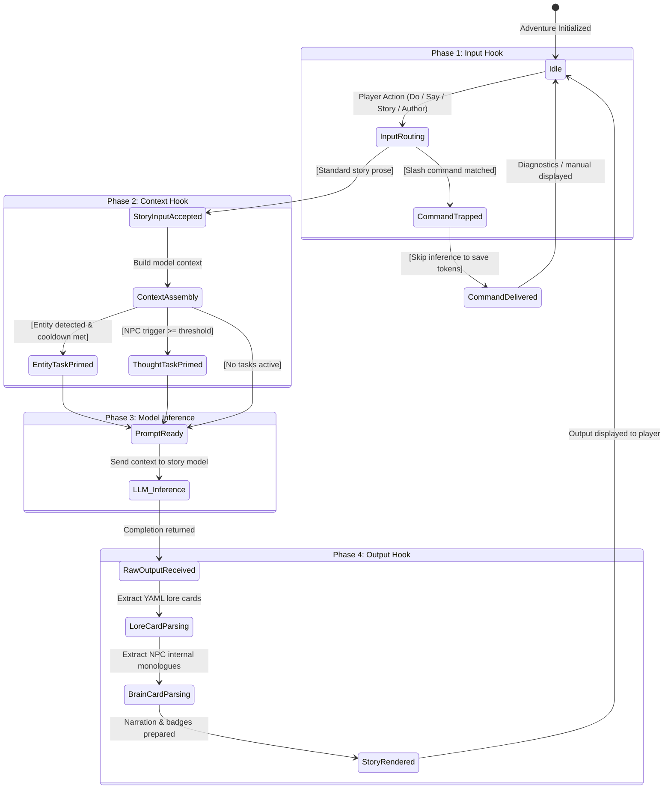
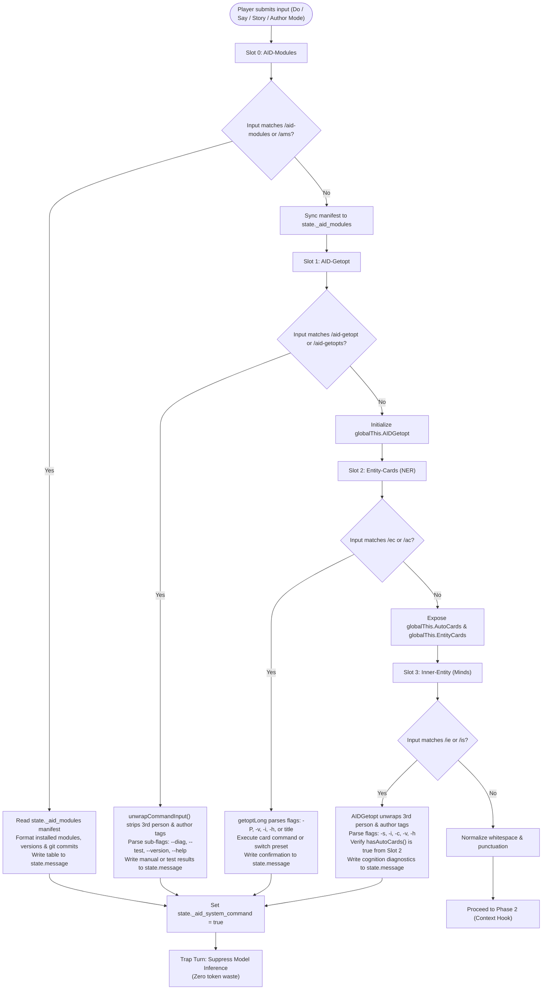
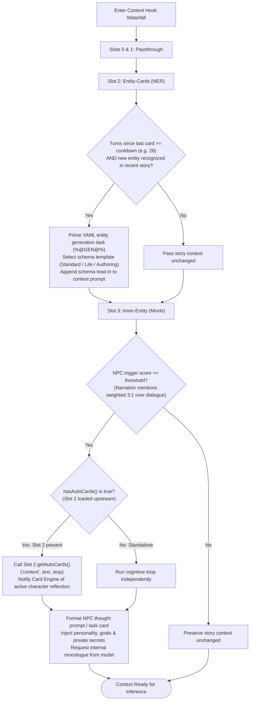
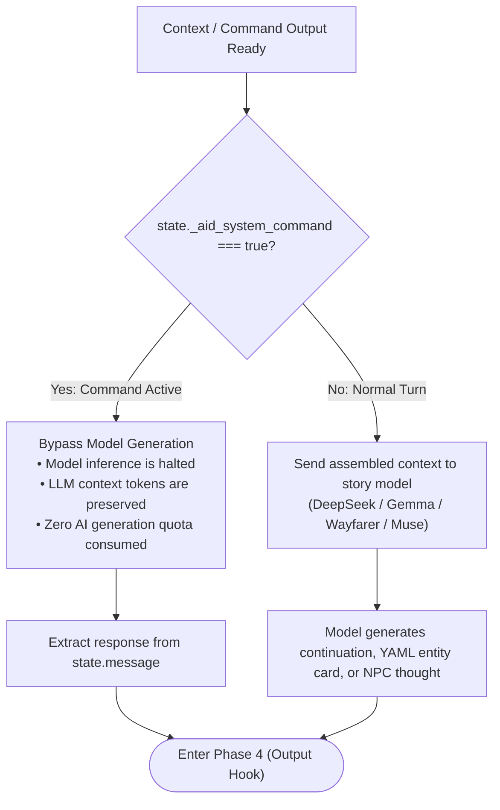
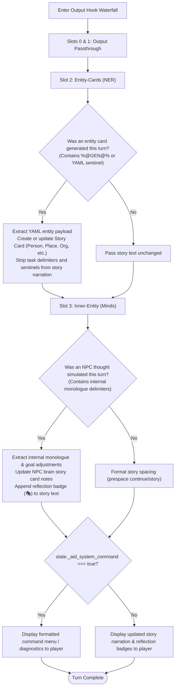

# Modular Ecosystem Execution Flow & Lifecycle Guide 🔄

This document details the turn lifecycle, state transitions, and execution waterfall across the 4-slot modular architecture in AI Dungeon:

```
Slot 0: AID-Modules (jHwEbn7_bYGC)
  ↓
Slot 1: AID-Getopt (Ka2D5sBoDFnn)
  ↓
Slot 2: Entity-Cards (05_w3s9zrrvt)
  ↓
Slot 3: Inner-Entity (bL_qS9DsI5wI)
```

By breaking each execution phase into its own dedicated diagram, the decision branches, edge conditionals, and cross-slot handoffs can be clearly traced.

---

## 1. High-Level Turn Lifecycle

AI Dungeon executes scripts in four sequential phases per turn:



---

## 2. Phase 1: Input Hook & Slash Command Routing

In Phase 1, each slot inspects the raw player input. If an input matches a slash command, it is unwrapped (stripping 3rd-person character names and author tags), parsed, written to `state.message`, and flagged with `state._aid_system_command = true` so the AI model is not invoked.



---

## 3. Phase 2: Context Hook & Task Injection

When normal story input is received, Phase 2 builds the context window sent to the AI story model. Slots 2 and 3 scan the narrative text to determine whether an entity card or an NPC thought should be generated.



---

## 4. Phase 3: Model Inference & Sandboxing

Phase 3 handles the handoff between scripted system commands and AI model generation:



---

## 5. Phase 4: Output Hook & Card Persistence

In Phase 4, the model's raw completion is intercepted. If an entity card or character thought was generated, it is parsed, stored in the player's Story Cards list, and cleaned from the story text.



---

## 6. Summary of Cross-Slot State & Globals

| Variable | Scope | Set By | Read By | Purpose |
| :--- | :---: | :---: | :---: | :--- |
| **`state._aid_modules`** | Persistent (`state`) | Slots 0, 1, 2, 3 | Slot 0 (`aid-modules`) | Cross-turn module discovery registry, tracking names, versions, and git commits. |
| **`state._aid_system_command`** | Turn-only (`state`) | Any matching slot | Phase 3 Sandbox & Phase 4 | Signals that a slash command was processed, halting LLM generation to save tokens. |
| **`state.message`** | Turn-only (`state`) | Any matching slot | Player UI | In-game notification banner used to display manuals and diagnostics. |
| **`globalThis.AIDGetopt`** | Turn-only (`globalThis`) | Slot 1 (`aid-getopt`) | Slots 2 & 3 | Standard POSIX/GNU flag parser and `unwrapCommandInput()` helper. |
| **`globalThis.AutoCards`** | Turn-only (`globalThis`) | Slot 2 (`Entity-Cards`) | Slot 3 (`Inner-Entity`) | Exposes the card engine API so Slot 3 can trigger entity generation via `getAutoCards()`. |
| **`hasAutoCards()`** | Function | Slot 3 (`Inner-Entity`) | Slot 3 (`Inner-Entity`) | Dynamic check (`typeof globalThis.AutoCards === "function"`) verifying Slot 2 is present. |
