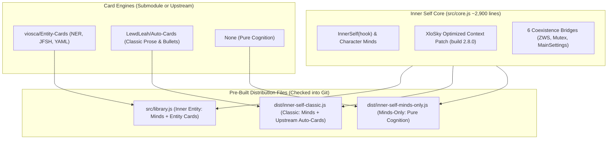

# Inner Entity & Entity Cards: Architecture & Peer Review Guide

**To:** LewdLeah  
**From:** Randy Viosca ([@Random_Variable on AI Dungeon](https://play.aidungeon.com/profile/Random_Variable))  
**Topic:** Architectural modularization, Named Entity Recognition (NER), and prompt cache optimization in Inner Self  

---

## Executive Summary

Hi Leah! ❤️

First, thank you for creating **Inner Self** and **Auto-Cards**. Your segmented memory architecture, autonomous character reflection, and mutual-exclusion coordination are among the most impressive engineering achievements in the AI Dungeon community.

Over the past months, players in the community have asked for two major additions:
1. **Named Entity Recognition (NER):** Automatic typing and token-calibrated YAML schemas for world lore (Person, Location, Organization, Thing, Event) via my **Entity Cards (EC)** mod.
2. **Optimized Context Compatibility:** Supporting AI Dungeon's server-side prompt caching via XloSky's dynamic task card patch.

In previous iterations, bundling these changes into `Inner-Self` resulted in a massive ~10,000-line monolithic script. Merging upstream updates between standalone `Auto-Cards` and embedded `Auto-Cards` was painful because embedded AC used `S.` prefixes on configuration settings, diverging from standalone AC.

**We solved this.** We have decoupled the project into a clean, modular architecture that:
- Reduces the functional changes in Inner Self's core to **fewer than 50 lines**.
- Makes the card engine a **100% byte-for-byte drop-in file** that can run standalone or embedded without any code differences.
- Provides a 1-second automated build (`npm run build:all`) and free GitHub Actions CI so players never have to install Node.js.
- Preserves all your original APIs, function names, and attributions, with 1-click toggling back to Classic Auto-Cards.

This document is a concise guide to help you review what was changed, why it was changed, and how it benefits your repositories if you choose to adopt any of it.

---

## 1. The Core Architecture (Before vs. After)

### Before (Monolithic 10,000-Line File)
Previously, `Inner-Self` contained a full copy of `Auto-Cards` pasted at the bottom, but with ~22 lines modified to use `S.FOO` instead of `const DEFAULT_FOO`. Standalone Auto-Cards and Embedded Auto-Cards drifted apart, making maintenance double the work.

### After (Modular Dual-Engine Architecture)



---

## 2. What Changed in `Inner-Self` Core (`src/core.js`)?

The core character cognition engine lives in `src/core.js` (~2,900 lines). The internal function is still named `function InnerSelf(hook)`, and all your original APIs remain intact.

The total diff against your upstream `Inner-Self` consists only of:

### A. XloSky's Optimized Context Patch (Build 2.8.0)
- **Prompt Caching Dual-Route:** When `info.useCacheEfficient === true`, Inner Self moves instructions into a dynamic task card (`🧠 Inner Self / Inner Entity Task — do not edit`), preventing cache invalidation on server-side model runners.
- **Narration vs. Dialogue Scoring (3:1 Weighting):** Names inside quotes (dialogue) are weighted down relative to narration mentions (`quotedMask`), preventing absent characters from thinking just because someone mentioned their name.
- **1st-Person Filtering (`namesSelf`):** Prevents the player character from forming third-person NPC thoughts.
- **Task Card Safety Net (`sanitizeTaskCards`):** Cleans up stale prompt task cards across turns.

### B. The 5 Lines of Entity Cards Glue
1. **Slash Command Regex in Input:**
   ```javascript
   // Recognizes /ec alongside /ac
   !/\/\s*(?:A|E)\s*C/i.test(text)
   ```
2. **Disabled Card Cleanup:**
   Purges `"Configure \nEntity Cards"` alongside `"Configure \nAuto-Cards"` when card automation is toggled off.
3. **`MainSettings.EntityCards` Presets:**
   Default schema presets added to `globalThis.MainSettings` alongside `MainSettings.AC`.
4. **Backward-Compatibility Aliases:**
   ```javascript
   function InnerEntity(hook) { return InnerSelf(hook); }
   globalThis.InnerSelf = InnerSelf;
   globalThis.InnerEntity = InnerEntity;
   ```

---

## 3. The "Zero-Diff" Discovery in Entity-Cards / Auto-Cards

In your original embedded Auto-Cards, you converted variables like `const DEFAULT_DO_AC = false` to `S.DEFAULT_DO_AC = false` so that `MainSettings` could override them.

We discovered that if we declare settings as **function-scoped `let`** inside `AutoCards(...)` and merge `MainSettings` right below:

```javascript
function AutoCards(inHook, inText, inStop) {
    "use strict";

    let DEFAULT_DO_AC = false;
    let DEFAULT_OPERATING_MODE = "entity";
    let DEFAULT_CARD_CREATION_COOLDOWN = 28;
    // ... all other defaults declared with let ...

    // Main settings override local settings (if present)
    if (typeof globalThis.MainSettings === "function") {
        const _ovr = {};
        new MainSettings("EntityCards", "AutoCards", "AC").merge(_ovr);
        for (const [k, v] of Object.entries(_ovr)) {
            try { eval(k + " = v;"); } catch (e) { /* ignore non-existent settings */ }
        }
    }
```

And guard the trailing initialization at the bottom of the file:
```javascript
if (typeof globalThis.InnerSelf !== "function" && typeof globalThis.InnerEntity !== "function") {
    AutoCards(null);
}
const EntityCards = AutoCards;
try { globalThis.EntityCards = AutoCards; } catch (_) {}
```

### Why This Is a Breakthrough:
1. **100% Code Sharing:** The exact same file `Entity-Cards/src/library.js` can now be pasted into AI Dungeon **standalone**, OR concatenated directly into `Inner-Self`.
2. **No Premature Execution:** When bundled with Inner Self, `AutoCards(null)` does not fire prematurely at script parse time; Inner Self coordinates invocation in proper sequence.
3. **Zero Divergence:** You never have to maintain two versions of Auto-Cards again.

---

## 4. What Does Entity Cards Add to Auto-Cards?

Entity Cards is a backward-compatible expansion of Auto-Cards:

| Feature | Classic Auto-Cards | Entity Cards (NER) |
| :--- | :--- | :--- |
| **Operating Mode** | Prose narrative & bulleted lists | Structured token-dense YAML schemas |
| **Card Types** | Single generic story card | 5 typed categories: `Person`, `Location`, `Organization`, `Thing`, `Event` |
| **Token Budgeting** | Variable length (~200–600 tokens) | Calibrated for AID's 100-token slider (~94 completion tokens) |
| **Prompt Language** | English prose directives | JellyFish (JFSH) pseudo-code prompts |
| **Story Card Layout** | Single Configure card | Two-Card architecture: Master (Auto-Cards) + Companion (Entity Cards) |
| **Immersion Cleanup** | Asterisk stripping | Fence stripping, delimiter fragment cleanup, zero-width space normalization |
| **1-Click Rollback** | N/A | In story card, switch `Operating mode: classic` to restore 100% classic Auto-Cards behavior |

---

## 5. Automated Build & Distribution Pipeline

To ensure non-developers never need to touch Node.js or Git submodules, we configured an automated build pipeline:

- **Local Build:** `npm run build:all` compiles all three targets in under 2 seconds:
  1. `src/library.js` — Flagship Inner Entity (Minds + Entity Cards)
  2. `dist/inner-self-classic.js` — Classic Inner Self (Minds + upstream Auto-Cards)
  3. `dist/inner-self-minds-only.js` — Mind-Only (Minds + prompt caching, zero card code, ~132 KB)
- **100% Free GitHub Actions (`.github/workflows/sync.yml`):**
  - Runs whenever `src/core.js` or the submodule updates.
  - Automatically runs unit tests (`node unittest/test_lifecycle.js`).
  - Commits pre-assembled distribution files directly into the repository.
  - Provides a **"Run workflow"** button under the GitHub Actions tab for one-click manual synchronization.

---

## 6. Unit Testing & OpenRouter Prompt Benchmarking

Inside `unittest/`, we added two developer tools:

1. **`unittest/test_lifecycle.js` (`npm test`):**
   Runs a mock AI Dungeon runtime environment testing all 3 distribution files, hook lifecycles, mutual exclusion yielding, and backward-compatibility aliases completely offline.
2. **`unittest/test_openrouter.js`:**
   A prompt tweaking harness that tests prompts against real models via [OpenRouter](https://openrouter.ai/) (DeepSeek V3, Gemma 2 27B, Llama 3 8B) to measure completion tokens, verify sentinel boundaries, and test template formatting. Full setup instructions are documented in `unittest/README.md`.

---

## 7. How We Can Collaborate

You have full freedom to adopt as much or as little of this as you like:
1. **Option A (Adopt the Submodule & Scoped Settings Pattern):**
   You can adopt the function-scoped `let DEFAULT_` pattern in `Auto-Cards` and the build script in `Inner-Self`. This immediately eliminates the need to manually maintain embedded AutoCards divergence.
2. **Option B (Support Entity Cards as a Switchable Engine):**
   You can link `Entity-Cards` as an optional submodule or alternative build target in your upstream repository.
3. **Option C (Keep as Upstream & Downstream Peers):**
   If you prefer to keep your repositories purely focused on Classic Auto-Cards, our repositories will continue to track your upstream commits cleanly, allowing players to choose either flavor freely.

All your original license terms, headers, and credits are fully preserved and celebrated.

Feel free to check out the branch at:  
👉 **[https://github.com/viosca/Inner-Entity](https://github.com/viosca/Inner-Entity)**  
👉 **[https://github.com/viosca/Entity-Cards](https://github.com/viosca/Entity-Cards)**

Thank you again for all your amazing work! ❤️

— Randy Viosca ([@Random_Variable](https://play.aidungeon.com/profile/Random_Variable))
