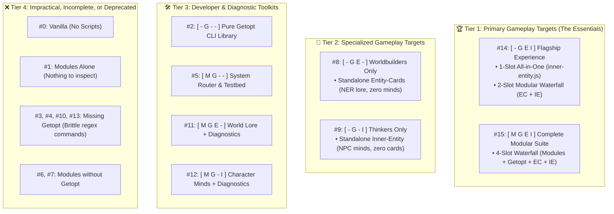

# Ecosystem Combinations Matrix: Standalone vs. All-in-One 🧩

This document explores all mathematically possible combinations ($2^4 = 16$) of the four core ecosystem modules:

* **M** = **AID-Modules** (AMS v1.1.0 registry & `/aid-modules`)
* **G** = **AID-Getopt** (POSIX/GNU option parser & 3rd-person/author unwrapper)
* **E** = **Entity-Cards** (Named Entity Recognition & YAML lorebook cards)
* **I** = **Inner-Entity** (Autonomous NPC minds, secrets & `🎭` reflection badges)

---

## 1. The 16-Combination Matrix

| # | Mask `[M G E I]` | Active Components | Deployment Model | Practicality Tier | Evaluation & Gameplay Utility |
| :-: | :-: | :--- | :--- | :-: | :--- |
| **0** | `[ - - - - ]` | *None* | Vanilla AI Dungeon | **Baseline** | **Zero scripts.** Pure vanilla AI Dungeon prompt engine. No automatic cards, minds, or CLI commands. |
| **1** | `[ M - - - ]` | Modules only | Single slot | ❌ **Useless** | **Pointless.** `aid-modules` is an inspector. Running it alone means `/aid-modules` has no downstream scripts to discover or report. |
| **2** | `[ - G - - ]` | Getopt only | Single slot (`library-aid-getopt.js`) | 🛠️ **Developer** | **Developer utility.** Used by scenario creators building custom RPG commands (`/roll`, `/inv`) from scratch, or running `/aid-getopt --test` benchmarks. |
| **3** | `[ - - E - ]` | EC only (No Getopt) | Single slot | ⚠️ **Deprecated** | **Sub-optimal.** Legacy Entity-Cards before getopt. Commands lack GNU/POSIX flag support and fail under 3rd-person (`> Jonathon /ec`). Replaced by #8. |
| **4** | `[ - - - I ]` | IE only (No Getopt) | Single slot | ⚠️ **Deprecated** | **Sub-optimal.** Legacy Inner Self. Pure regex command matching fails under 3rd-person mode and authoring preambles. Replaced by #9. |
| **5** | `[ M G - - ]` | Modules + Getopt | Scenario (`Ka2D5sBoDFnn`) | 🛠️ **Developer** | **Master System Suite.** Provides `/aid-modules` and `/aid-getopt` diagnostics with output sandboxing. Useful for script developers; adds no game lore/minds. |
| **6** | `[ M - E - ]` | Modules + EC (No Getopt) | 2 slots | ❌ **Impractical** | **Illogical.** Adds an ecosystem registry to EC but skips the CLI parser, leaving `/ec` commands brittle. |
| **7** | `[ M - - I ]` | Modules + IE (No Getopt) | 2 slots | ❌ **Impractical** | **Illogical.** Same as #6; character minds without command unwrapping paired with an unnecessary inspector. |
| **8** | `[ - G E - ]` | **Getopt + EC** | **Standalone Scenario** (`05_w3s9zrrvt`) | 🌟 **Core Practical** | **The Lore Master.** Automated Named Entity Recognition, MBTI character profiles, and YAML lorebook cards with full `/ec` flag parsing. Zero mind overhead. |
| **9** | `[ - G - I ]` | **Getopt + IE** | **Standalone Scenario** (`bL_qS9DsI5wI`) | 🌟 **Core Practical** | **The Pure Thinkers.** Autonomous NPC minds, goals, secrets, and thought badges (`🎭`), while keeping Story Cards 100% clean (no automated lore cards). |
| **10** | `[ - - E I ]` | EC + IE (No Getopt) | 2 slots or legacy bundle | ⚠️ **Deprecated** | **Historic legacy.** Minds + Cards working together, but relying on fragile regex for `/ec` and `/ie`. Replaced by #14. |
| **11** | `[ M G E - ]` | Modules + Getopt + EC | 2 or 3 slots | 🔍 **Specialized** | **Worldbuilder Pro.** Dedicated world lore tracking + full `/aid-modules` ecosystem introspection. |
| **12** | `[ M G - I ]` | Modules + Getopt + IE | 2 or 3 slots | 🔍 **Specialized** | **Character RP Pro.** Pure character minds + full `/aid-modules` ecosystem introspection. |
| **13** | `[ M - E I ]` | Modules + EC + IE (No Getopt) | 2 or 3 slots | ❌ **Impractical** | **Inconsistent.** Full gameplay engines running without a standardized command parser, despite including an ecosystem manager. |
| **14** | `[ - G E I ]` | **Getopt + EC + IE** | **Flagship All-in-One** (`dist/inner-entity.js`) *OR* **2-Slot Waterfall** | 🏆 **Definitive Flagship** | **The Premier Player Setup.** Living NPC minds + automated YAML lore cards + universal 3rd-person CLI command parsing. Available as 1-slot bundle or 2-slot waterfall. |
| **15** | `[ M G E I ]` | **Full 4-Module Suite** | **4-Slot Waterfall** *OR* **2-Slot Hybrid** | 👑 **Ultimate Suite** | **The Maximum Modular Suite.** Every subsystem active with dedicated toggles: minds, cards, CLI getopt diagnostics, and live `/aid-modules` cross-slot tracking. |

---

## 2. Practicality Tiers & Architectural Categorization

The 16 combinations naturally group into 4 functional tiers:



---

## 3. Detailed Variant Analysis

### Tier 1: Primary Gameplay Variants

#### Variant #14: The Definitive Flagship `[ - G E I ]`
* **Components:** `AID-Getopt` + `Entity-Cards` + `Inner-Entity`
* **Why it is the gold standard:** It delivers the full AI Dungeon immersion experience—characters have inner thoughts and secrets, the world is cataloged into token-efficient YAML story cards, and all commands (`/ie`, `/ec`) unwrap cleanly in 1st person, 3rd person, and authoring mode.
* **Two Deployment Forms:**
  1. **All-in-One Bundle (1 Slot):** Paste `dist/inner-entity.js` into a single script slot. Zero configuration, zero slot juggling.
  2. **Modular Pair (2 Slots):**
     * Slot 1: `Entity Cards (NER)` (`05_w3s9zrrvt`)
     * Slot 2: `Inner Entity (Minds)` (`bL_qS9DsI5wI`)
     * *Advantage:* Allows updating card presets or cooldowns without touching character minds.

#### Variant #15: The Ultimate Modular Suite `[ M G E I ]`
* **Components:** `AID-Modules` + `AID-Getopt` + `Entity-Cards` + `Inner-Entity`
* **Why it exists:** For power users who want independent control over every subsystem. Every component has its own toggle in the Script Manager.
* **Deployment Options:**
  1. **4-Slot Waterfall:**
     * Slot 0: `AID-Modules` (`jHwEbn7_bYGC`)
     * Slot 1: `AID-Getopt` (`Ka2D5sBoDFnn`)
     * Slot 2: `Entity Cards (NER)` (`05_w3s9zrrvt`)
     * Slot 3: `Inner Entity (Minds)` (`bL_qS9DsI5wI`)
  2. **2-Slot Hybrid:**
     * Slot 0: `AID-Getopt Router` (combines Modules + Getopt + Sandbox)
     * Slot 1: `Inner Entity Flagship` (`dist/inner-entity.js`, combines EC + IE)

---

### Tier 2: Specialized Gameplay Variants

#### Variant #8: The Worldbuilder `[ - G E - ]`
* **Components:** `AID-Getopt` + `Entity-Cards`
* **Deployment:** Standalone `Entity Cards (NER)` (`05_w3s9zrrvt` / `Entity-Cards/src/library.js`).
* **Best for:** Authors and players who want rich, automated lore tracking (people, places, items, factions) but do **not** want NPCs simulating private thoughts or displaying `🎭` reflection badges.

#### Variant #9: The Pure Thinker `[ - G - I ]`
* **Components:** `AID-Getopt` + `Inner-Entity`
* **Deployment:** Standalone `Inner Entity (Minds)` (`bL_qS9DsI5wI` / `dist/inner-self-minds-only.js`).
* **Best for:** Players who want character psychological depth and internal monologues, but want their Story Cards list kept completely clean (zero automated card creation).

---

### Tier 3: Developer & Diagnostic Toolkits

* **Variant #2 `[ - G - - ]`:** Pure `library-aid-getopt.js`. For script creators writing their own custom slash commands from scratch.
* **Variant #5 `[ M G - - ]`:** `AID-Getopt Router` (`Ka2D5sBoDFnn`). A lightweight system testbed for benchmarking QuickJS, testing argument tokenization, and running `/aid-modules`.
* **Variants #11 & #12:** Specialized variants where a player runs only one gameplay engine (either Cards or Minds) but includes `AID-Modules` in Slot 0 to monitor versions and state health.

---

### Tier 4: Why the Remaining Variants Are Impractical

1. **The "Getopt Invariant" (#3, #4, #10, #13):** Any configuration with EC or IE that omits `AID-Getopt` is fundamentally brittle. In 3rd-person games (`> Jonathon /ie -s`) or authoring prompts (`[AI, polish...] Author as Jonathon /ec -v`), raw regex parsers fail to match. Because getopt is now embedded into EC and IE, these un-parsed variants are obsolete.
2. **The "Orphaned Registry" (#1, #6, #7):** `AID-Modules` is a discovery and introspection tool. Running it alone (#1) or with half a stack (#6, #7) without standard CLI routing provides zero gameplay benefit.

---

## 4. Summary: How to Choose Your Setup

```
Do you want automated Lore / Story Cards?
 ├── NO  ──> Do you want simulated NPC Minds?
 │            ├── NO  ──> #0: Vanilla AI Dungeon (No Scripts)
 │            └── YES ──> #9: Inner Entity (Minds-Only) [1 Slot]
 │
 └── YES ──> Do you want simulated NPC Minds?
              ├── NO  ──> #8: Entity Cards (NER) [1 Slot]
              └── YES ──> Do you want single-slot convenience or multi-slot control?
                           ├── Single-Slot ──> #14: Inner Entity Flagship All-in-One [1 Slot]
                           ├── Two-Slot    ──> #14: Entity Cards (Slot 1) + Inner Entity (Slot 2)
                           └── Four-Slot   ──> #15: Modules + Getopt + Cards + Minds [4 Slots]
```
